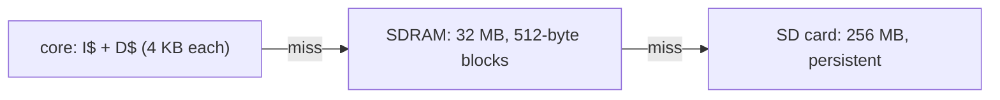

# risc-v-sv

In-order RV32IMA (+ Zicsr, Zicntr, Zifencei) core in SystemVerilog, simulated
with Verilator.

Classic 5-stage pipeline: IF, ID, EX, MEM, WB.

- Results are forwarded to EX from MEM and WB; ID bypasses the register
  being written back in the same cycle.
- A load followed by an instruction that uses its result stalls for one cycle.
- Fetch predicts branches not taken; a taken branch or jump is resolved in EX
  and squashes the two instructions behind it.
- Multiplication is single-cycle; DIV/REM use a 34-cycle iterative divider
  (`rtl/divider.sv`) while IF/ID/EX stall.
- Atomics (LR/SC with a one-address reservation, AMO read-modify-write) run in
  MEM. FENCE.I writes back the data cache, invalidates the instruction cache
  and refetches.
- Machine mode only, with precise traps: exceptions (illegal instruction,
  ECALL, EBREAK, misaligned jump target, misaligned atomic, load/store access
  fault), interrupts, MRET, FENCE.I and CSR instructions take effect in MEM and
  squash everything younger. The CSRs are in `rtl/csr.sv`; the performance
  counters `mhpmcounter3–31`/`mhpmevent3–31` and `mconfigptr` read as 0.
- Interrupts: machine software/timer/external inputs (`mip` bits 3/7/11),
  priority external > software > timer. WFI stops fetching until an
  interrupt enabled in `mie` is pending. The testbench drives the inputs from
  a program's `irq_lines` word (bits 31:16 delay a new value by that many
  cycles) until a CLINT/PLIC exists.

Tests report their result through a `tohost` word in memory, the riscv-tests
convention: 1 = pass, `(failing test number << 1) | 1` = fail. The testbench
watches that address; the Makefile reads it from the ELF.

## System

`rtl/soc.sv` is the whole system at 50 MHz: the core (`cu`, with its
caches), the address decoder `rtl/bus.sv`, and main memory: the SD card,
cached in the SDRAM by `rtl/sd_mem.sv`. Memory map (`rtl/memmap.sv`):

| Range | Device |
|---|---|
| `0x1000_1000`–`0x1000_1FFF` | memory controller registers (uncached; aligned loads/stores, no atomics) |
| `0x8000_0000`–`0x8FFF_FFFF` | main memory: 256 MB, stored on the SD card. Programs are linked here (`test/link.ld`) and reset starts here |
| everything else | nothing. Fetches read 0 (illegal instruction); loads and stores are access faults |

Device accesses bypass the data cache: one single-word request each. They
can have side effects, so an interrupt waits until the access's instruction
has completed instead of re-running it after MRET.

## Main memory on the SD card

Memory is a hierarchy, and software sees none of it:

Main memory byte k is byte k of the card, used raw (no partition table):
the system boots from the card's first block. `rtl/sd_mem.sv` keeps
512-byte blocks of it in the SDRAM, direct-mapped (block b in SDRAM slot
b mod 65536, one on-chip tag per slot). A miss in the SDRAM writes the
slot's block to the card if it was modified, then reads the wanted block
from the card. Each card transfer takes about 0.35 ms (SPI at 12.5 MHz), so
a miss costs 0.35–0.7 ms; hits cost the SDRAM's latency. After reset the
card's initialisation (about 3 ms) delays the first fetch.

Data reaches the card when its block is evicted, or on FLUSH. Whatever is
only in the SDRAM or the data cache is lost at power-off, so software syncs:

    fence.i                  # writes back the data cache (this core)
    sw   zero, 4(ctrl)       # FLUSH: write every modified block to the card
1:  lw   t0, 0(ctrl)         # STATUS: wait until BUSY clears
    andi t1, t0, 2
    bnez t1, 1b              # then check ERROR (bit 2)

| Offset | Register |
|---|---|
| `0x000` | STATUS (read-only): bit 0 READY (card initialised), 1 BUSY (flushing), 2 ERROR (a card transfer failed; sticky until reset), 3 INIT_ERROR (no usable card), 4 SDHC |
| `0x004` | FLUSH (write anything) |

Without a usable card, misses leave memory contents undefined and set
ERROR. The card's capacity is not checked (`sd_spi.sv` does not read the CSD
register): it must hold at least 256 MB.

The testbench (`tb/top.sv`) wires the SoC to the SD card model
`ulx3s/tb/models/sd_card_model.sv` and the SDRAM chip model
`ulx3s/tb/models/sdram_model.sv`. Both stop the simulation on any protocol
or timing violation. As on the board, the SDRAM chip runs on the inverted
clock. `+bin=<file>` writes a program to the start of the card.
`+sd_image=<file>` makes a disk image the card's contents (zeros past its
end) and writes the card back to it when the simulation ends: only what was
flushed or evicted survives, as on hardware. Images are sparse files.
Without an image, card bytes the program does not load hold the model's
fill pattern, not zeros. `make sd-tests` boots `test/sd/persist.S` twice
from one image: the second boot gets nothing but the image the first one
left.

## Caches

Split instruction and data caches (`rtl/cache.sv`) share one memory port
through `rtl/mem_arbiter.sv`, with the data cache first. The port uses the
request interface of `ulx3s/rtl/sdram.sv` (one burst per line) with 30-bit
word addresses. A line refill whose block is in the SDRAM takes about 20
cycles; periodic SDRAM refreshes add more, and blocks not in the SDRAM come
from the card (see above).

- N-way set-associative, tree-PLRU replacement (true LRU at 2 ways),
  write-back and write-allocate. Shape per cache: `WAYS` (1 = direct-mapped),
  `SETS` (≥ 2) and `LINE_WORDS` (2–8, one SDRAM burst). The default is
  2 ways × 64 sets × 8 words = 4 KB each.
- Lookups are combinational, so a hit costs no extra cycle. An instruction
  cache miss sends bubbles into ID. A data cache miss holds MEM and
  everything behind it; an interrupt can still be taken meanwhile. A dirty
  victim is written back before the refill.
- Misaligned loads and stores still work. One that spans two lines needs
  both lines present.
- FENCE.I waits until every dirty line is written back (the lines stay
  cached, clean), then invalidates the instruction cache.
- The testbench reads `tohost` and `irq_lines` through the data cache.

Choose the shapes with top-level parameters `IC_WAYS`, `IC_SETS`,
`IC_LINE_WORDS`, `DC_WAYS`, `DC_SETS` and `DC_LINE_WORDS` (`tb/top.sv`,
passed through `rtl/soc.sv`). Build each setting in its own directory:

    make riscv-tests BUILD=build/dm SIMFLAGS="-GIC_WAYS=1 -GDC_WAYS=1"

`make cache-configs` runs `riscv-tests` and `priv-tests` again with
direct-mapped, 4-way and tiny caches (2 sets of 2-word lines, constant
evictions). Cache-specific tests: `test/isa/cache.S` and
`test/priv/cache_irq.S` (interrupts while MEM waits for a refill).

## Requirements

- Verilator 5
- RISC-V GCC toolchain (`RISCV_PREFIX`, default `riscv64-linux-gnu-`)
- riscv-tests submodule with its `env` submodule:
  `git submodule update --init --recursive`

## Usage

    make simulate      # build test/test.S and run it with an instruction trace
    make riscv-tests   # rv32ui, rv32um, rv32ua + test/isa/*.S
    make priv-tests    # machine-mode tests: rv32mi + test/priv/*.S (TODO.md step 1)
    make sd-tests      # boot twice from one SD card image: memory persists
    make               # simulate + riscv-tests + priv-tests + sd-tests + cache-configs
    make cache-configs # both suites again with other cache shapes
    make lint
    make dasm          # disassemble test/test.S
    make simulate TEST=path/to/prog    # any program that defines and writes `tohost`

Testbench plusargs: `+bin=<file>`, `+tohost=<hex address>`, `+irq=<hex address>`,
`+sd_image=<file>`, `+max_cycles=<n>` (default 4000000, counted from reset),
`+trace`.

## ULX3S drivers

`ulx3s/` holds the board's SDRAM controller and SD card (SPI mode) controller
with their simulation models; see `ulx3s/README.md`. `make -C ulx3s` runs
their tests (also in CI), `make -C ulx3s synth` checks them with
yosys/nextpnr-ecp5. Both are part of the SoC: the card is main memory and
the SDRAM caches it.
